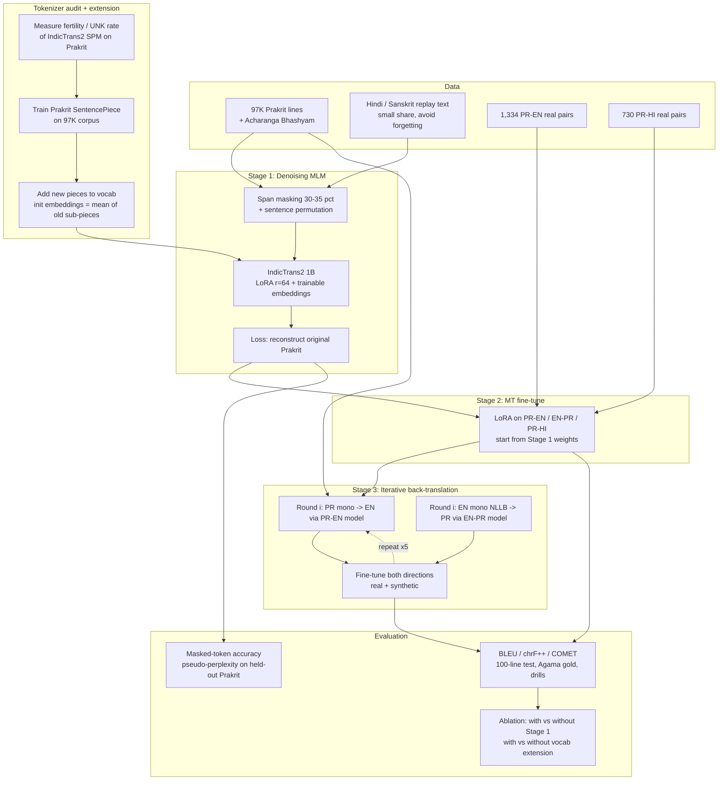
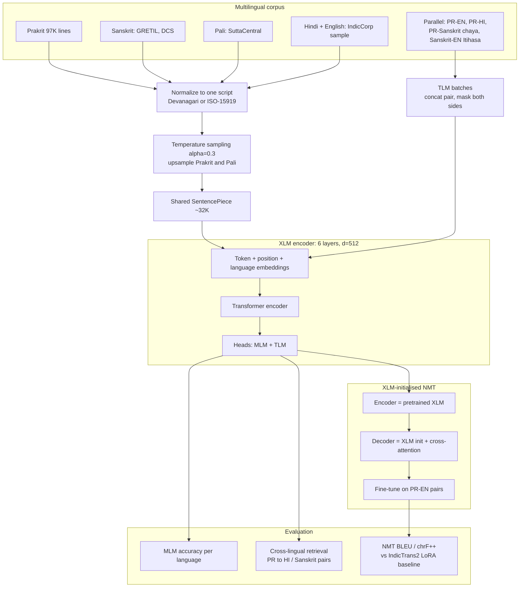
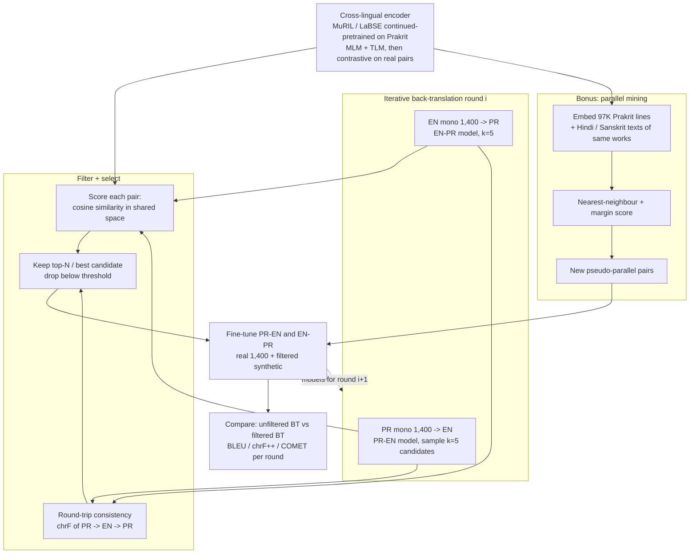
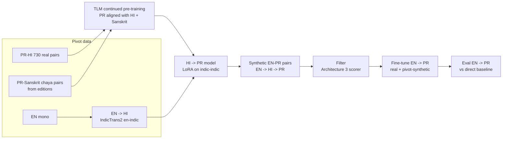

# Cross-Lingual MLM for Prakrit — Architecture Options

How NLP topic #25 (Cross-Lingual MLM for Low-Resource Languages) can plug into the existing Prakrit MT work in `Prakrit_PP`.

## Starting point (what already exists)

| Asset | Size / status |
|---|---|
| Real Prakrit–English pairs | ~1,334 (Sattasai + Kaggle parallel_corpus + Saman Suttam) |
| Real Prakrit–Hindi pairs | ~730 (grammar drills + Agama), noisy/narrow |
| Monolingual Prakrit | 97,139 lines across 36 texts + 23,727 Acharanga Bhashyam lines |
| Prakrit dictionary | ~20K entries |
| Best PR→EN | IndicTrans2 indic-en-1B + LoRA (Exp 004: BLEU 9.81 / chrF++ 25.30 on 100-line test) |
| Best PR→HI | IndicTrans2 indic-indic-1B + LoRA, domain mix (Exp 005) |
| Planned next | Iterative back-translation, 5 rounds × 1,400 sentences |
| Known gap | No Prakrit language tag or Prakrit-aware tokenizer; Prakrit is routed as `hin_Deva` |

The monolingual corpus (97K lines) is the most underused asset so far. An MLM stage is exactly what turns it into model quality.

---

## Architecture 1 — Continued denoising pre-training of IndicTrans2 (recommended)

Adapt the model you already use to Prakrit **before** the MT fine-tune. Since IndicTrans2 is an encoder–decoder, use mBART-style span masking (the seq2seq form of MLM): mask spans in Prakrit text and train the model to reconstruct the original.

Optionally extend the tokenizer with Prakrit subwords first. This directly addresses the "check the IndicTrans2 vocabulary" item in the plan doc.

**Why it fits:** a small, clear change to the existing pipeline. Continued pre-training on ~100K lines is feasible on one GPU with LoRA. The course deliverable is measurable in two ways: MLM metrics, plus the BLEU gain from Stage 1.

**Risk:** Hindi/English quality can degrade from forgetting. Mitigate with the replay text and by evaluating Hindi→English as well.

---

## Architecture 2 — Small XLM from scratch (MLM + TLM), then an XLM-initialised NMT

The "pure" version of topic #25. Build a multilingual encoder where Prakrit shares a space with its relatives, then use it to initialise a translation model.

97K lines alone (roughly 1–2M tokens) is too little to pre-train from scratch. Sanskrit, Pali and Hindi text are required as bridges.

**Why it fits:** the most original, textbook version of #25, with a new Prakrit-aware tokenizer and model.

**Risk:** it will almost certainly score below IndicTrans2-1B on BLEU. Frame the result as "what a small, Prakrit-aware model learns", not as a new state of the art. It needs the most data work and compute.

---

## Architecture 3 — The MLM as a data engine for back-translation

Don't use the MLM as the translator. Use a cross-lingual encoder to make the synthetic data in your iterative back-translation plan cleaner. Noisy synthetic pairs are the main way back-translation fails with only 1,400 seed pairs.

**Why it fits:** it plugs straight into the planned iterative back-translation experiments and gives a clean research question: "Does a Prakrit-adapted cross-lingual encoder improve back-translation data quality?"

**Risk:** the encoder is only as good as its alignment, and 1,334 pairs is thin for contrastive training. Validate retrieval accuracy on held-out real pairs first.

---

## Architecture 4 — Hindi / Sanskrit pivot with TLM

Use a related language as a bridge. Train on Prakrit↔Hindi and Prakrit↔Sanskrit (chāyā) TLM so Prakrit lands near Hindi and Sanskrit in the shared space. Then generate synthetic data through the pivot. This matches the "Use Hindi as pivot" item in the plan doc.

**Why it fits:** EN→PR is the weaker direction, and Hindi and Prakrit share a lot of vocabulary and morphology, so pivot data should be cheap and plentiful.

**Risk:** errors compound across two translation steps, and the Hindi→Prakrit side is currently weak (Exp 005). Filtering is essential.

---

## Comparison

| | Arch 1: Continued denoising | Arch 2: XLM from scratch | Arch 3: MLM data engine | Arch 4: Pivot + TLM |
|---|---|---|---|---|
| Fits topic #25 | Good | Best | Good | Medium |
| Reuses current pipeline | High | Low | High | Medium |
| Compute | 1 GPU, LoRA, days | Most (multilingual pre-train) | Low–medium | Medium |
| Data work | Low | High (Sanskrit/Pali collection) | Low | Medium (chāyā extraction) |
| Expected BLEU gain | Likely | Unlikely vs IT2-1B | Likely, via cleaner BT | Mainly EN→PR |
| Solo, by hand | ~4–6 weeks | ~10–14 weeks | ~4–5 weeks | ~5–6 weeks |
| Novelty for a paper | Medium | Medium–high | High | Medium |

## Recommendation

**For the course and the research track together: Architecture 1 + Architecture 3.**

1. Audit and extend the tokenizer, then run continued denoising pre-training on the 97K Prakrit lines. This is the #25 deliverable, with its own MLM metrics.
2. Use the adapted encoder (or a MuRIL model adapted the same way) as the scorer that filters back-translation candidates.
3. Run the planned 5-round iterative back-translation in four settings: base / +Stage 1 / +filtering / +both. That 2×2 ablation gives a clean results table.

Add Architecture 4 later if EN→PR still lags. Keep Architecture 2 only if the course explicitly requires building the MLM from scratch; if so, keep it small and report it as a separate, analysis-focused result.

## Evaluation checklist

- **MLM:** masked-token accuracy and pseudo-perplexity on a held-out 5% of Prakrit lines, split by text (no leakage across the same work).
- **Tokenizer:** fertility (tokens per word) and UNK rate, before and after vocab extension.
- **MT:** BLEU, chrF++ and COMET on the 100-line test, Agama gold and grammar drills. Report each domain separately, as in Exp 005.
- **Alignment:** PR↔EN and PR↔HI retrieval accuracy (top-1) on held-out real pairs.
- **Leakage check:** make sure test sentences are not in the monolingual pre-training corpus.
